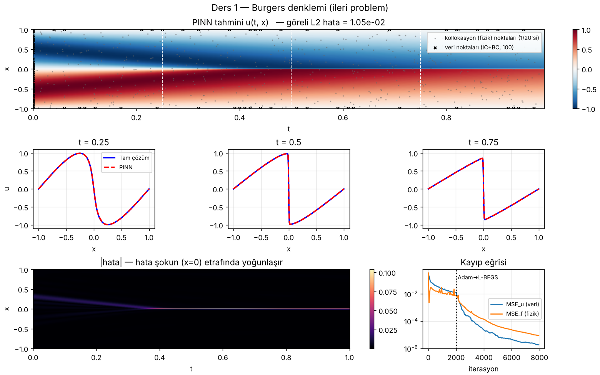
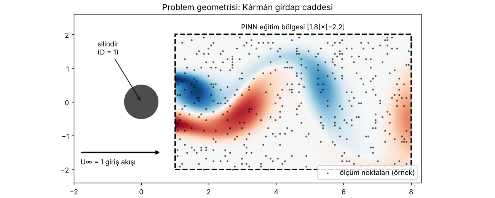
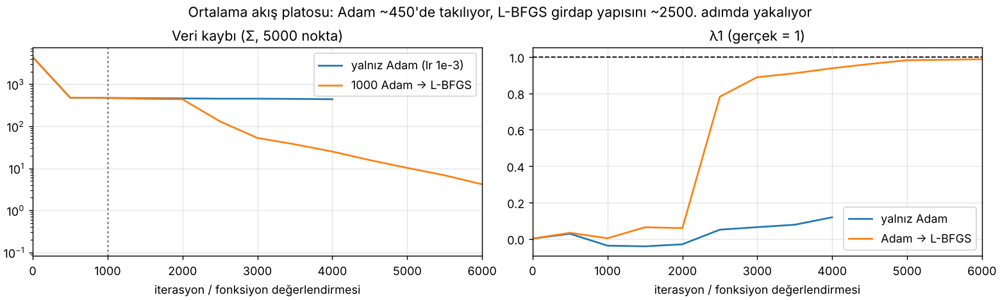
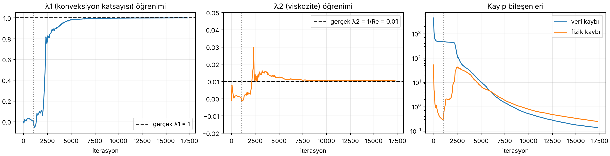
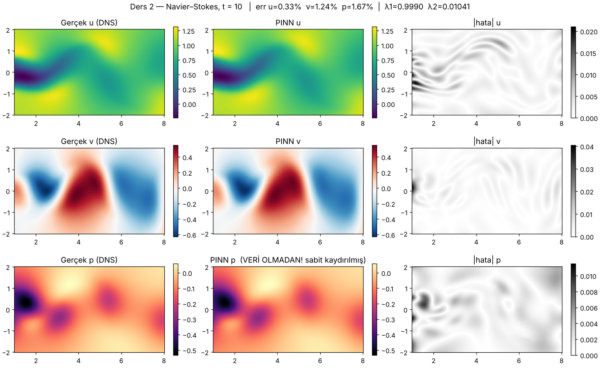

# Kolay PINN: CFD için Physics-Informed Neural Networks

Bu repo, PINN'leri **akışkanlar dinamiği (CFD)** odağında adım adım öğrenmek için hazırlandı.
Temel aldığı proje, PINN alanının en çok yıldız alan ve en çok atıf yapılan deposu:

> **[maziarraissi/PINNs](https://github.com/maziarraissi/PINNs)**: Raissi, Perdikaris, Karniadakis,
> *"Physics-informed neural networks…"*, Journal of Computational Physics 378 (2019) 686–707.

Orijinal kod TensorFlow 1.x ile yazılmış (`tf.Session`, `tf.placeholder`, `tf.contrib`) ve güncel
Python'da çalışmıyor. Bu yüzden iki temel örnek **PyTorch'a birebir taşındı**, eğitildi ve
tüm grafikler bu çalıştırmalardan üretildi.

📘 **Görsel ders sayfası:** [`ders.html`](ders.html) (tarayıcıda açın; tüm görseller ve kod açıklamaları orada)

---

## İçindekiler

| # | Ders | Dosya | Ne öğrenirsin |
|---|------|-------|----------------|
| 0 | Veriyi tanı | `src/00_explore_data.py` | Silindir arkası akış (Re=100), Kármán girdapları, `.mat` yapısı |
| 1 | Burgers (ileri problem) | `src/01_burgers_forward.py` | Kalıntı, autograd, kollokasyon noktaları, Adam → L-BFGS |
| 2 | Navier–Stokes (ters problem) | `src/02_navier_stokes_inverse.py` | Akım fonksiyonu ψ, λ1/λ2 keşfi, veri olmadan basınç |
| 3 | Sonuç grafikleri | `src/03_plot_results.py` | Hata haritaları, λ yakınsaması |
| – | Ortak çekirdek | `src/pinn_core.py` | MLP (normalizasyon + tanh), `grad` yardımcıları |

## Hızlı başlangıç

```bash
pip install torch scipy matplotlib
bash data/download_data.sh                 # cylinder_nektar_wake.mat (24 MB) indirir
python src/00_explore_data.py
python src/01_burgers_forward.py           # ~6 dk CPU
python src/02_navier_stokes_inverse.py --adam 1000 --lbfgs 15000   # ~1 saat CPU (GPU'da dakikalar)
python src/02_navier_stokes_inverse.py --noise 0.01 --tag noisy     # gürültülü veri deneyi
python src/03_plot_results.py
```

---

## 1. PINN fikri tek cümlede

Çözümü bir sinir ağı olarak yaz, `(x, y, t) → (u, v, p)`; türevleri **autograd** ile tam olarak al,
denkleme koy ve sıfırdan sapmayı (kalıntıyı) kayba ekle:

```
Kayıp = ‖ölçüm − ağ‖²  +  ‖PDE kalıntısı‖²
```

Mesh yok, ayrıklaştırma yok. Fizik kaybı **etiketsiz** noktalarda hesaplanabildiği için çok az veriyle çalışır.

## 2. Orijinal depo yapısı

```
maziarraissi/PINNs
├── main/
│   ├── Data/                         .mat dosyaları (cylinder_nektar_wake.mat, KdV.mat, NLS.mat, AC.mat)
│   ├── continuous_time_identification (Navier-Stokes)/NavierStokes.py   ★ CFD örneği
│   ├── continuous_time_inference (Schrodinger)/
│   ├── discrete_time_identification (KdV)/
│   └── discrete_time_inference (AC)/
├── appendix/
│   ├── Data/burgers_shock.mat
│   └── continuous_time_inference (Burgers)/Burgers.py                  ★ ilk okunacak
└── Utilities/  plotting.py, IRK_weights/ (Runge–Kutta Butcher tabloları)
```

Klasör adları iki eksenden gelir:
- **continuous time**: `t` ağa girdi olarak verilir. **discrete time**: zaman yüksek mertebeli implicit Runge–Kutta ile adımlanır.
- **inference**: ileri problem (denklem biliniyor, çözümü bul). **identification**: ters problem (katsayıları bul).

## 3. Ders 1: Burgers

`u_t + u·u_x − (0.01/π)·u_xx = 0`. Navier–Stokes'un 1B kardeşi; x=0'da şok oluşur.
100 sınır/başlangıç noktası + 10 000 etiketsiz kollokasyon noktası.



**Bu çalıştırma:** göreli L2 hata **%1.05**, CPU'da 5.6 dk.

## 4. Ders 2: Navier–Stokes ters problemi

```
u_t + λ1(u u_x + v u_y) = −p_x + λ2(u_xx + u_yy)
v_t + λ1(u v_x + v v_y) = −p_y + λ2(v_xx + v_yy)      gerçek: λ1 = 1, λ2 = 0.01
```



Üç kritik fikir:
1. **Akım fonksiyonu**: ağ `(ψ, p)` üretir; `u = ψ_y`, `v = −ψ_x` → süreklilik `u_x + v_y = 0` otomatik sağlanır.
2. **Eğitilebilir fizik**: `λ1`, `λ2` birer `nn.Parameter`, ağırlıklarla birlikte öğrenilir.
3. **Gizli basınç**: `p` için hiç veri yok; yalnızca momentum denklemi onu belirler (bir sabite kadar).

**Bu çalıştırmanın sonuçları** (CPU, 1 000 Adam + ~16 000 L-BFGS, 57 dk):

| Büyüklük | Gerçek | PINN | Hata | Makale |
|---|---|---|---|---|
| λ1 | 1.000 | 0.9990 | %0.097 | %0.078 |
| λ2 | 0.01000 | 0.01041 | %4.08 | %4.67 |
| u alanı (t=10) | | | %0.33 | |
| v alanı (t=10) | | | %1.24 | |
| p alanı (veri yok!) | | | %1.67 (sabit kaydırılmış; ham %1039) | |

> **Plato dersi:** Yalnız Adam (lr=1e-3) ile ilk denemede veri kaybı ~450'de takıldı (ağ sadece ortalama akışı öğrendi).
> 1 000 Adam adımından sonra L-BFGS'e geçince plato ~2 500. adımda kırıldı. Bkz. `figures/02_ns_plateau.png`,
> log: `results/ns_adam_only_attempt.log`.






## 5. Bilmen gereken kod detayları

| Detay | Neden önemli |
|-------|--------------|
| `H = 2(X−lb)/(ub−lb) − 1` | Girdiler [-1,1]'e; aksi halde tanh doyar |
| `tanh` aktivasyon | ReLU'nun 2. türevi 0 → `u_xx` hep 0 olur |
| `create_graph=True` | Türevin türevi ve ağırlık gradyanı için graf korunur |
| Kollokasyon noktaları | Fizik kaybı etiketsiz noktalarda; orijinal Latin Hypercube kullanır |
| Adam → L-BFGS | Adam kaba arama, L-BFGS ince ayar (full-batch) |
| `reduce_sum` (NS) / `reduce_mean` (Burgers) | Kayıp ölçeği değişir; L-BFGS toleranslarını etkiler |
| Eşit ağırlıklı kayıp | Zor problemlerde dengesizlik → uyarlanabilir ağırlıklar (NTK, SA-PINN) |
| Basınç sabiti | `p + C` de çözüm; karşılaştırmada ortalama eşitlenir |

## 6. Alıştırmalar

1. Burgers'te `tanh` → `relu`. Ne oluyor, neden?
2. Kollokasyon sayısını 10 000 → 500'e indir.
3. NS'de giriş normalizasyonunu kaldır.
4. NS'de `N_train = 1000` ile λ2 hâlâ bulunuyor mu?
5. ψ hilesini kaldır, ağ doğrudan `(u, v, p)` üretsin, kayba `(u_x+v_y)²` ekle.
6. `--noise 0.01` ile çalıştır (makale: λ2 hatası %4.67 → %5.70).

## 7. Sonraki adımlar

- [DeepXDE](https://github.com/lululxvi/deepxde): geometri/sınır koşulu hazır PINN kütüphanesi
- [NVIDIA PhysicsNeMo](https://github.com/NVIDIA/physicsnemo): endüstriyel ölçek 3B CFD
- [pinns-torch](https://github.com/rezaakb/pinns-torch): orijinal deponun önerdiği modern PyTorch sürümü

---
Veri ve orijinal kod: MIT lisansı, © Maziar Raissi.
