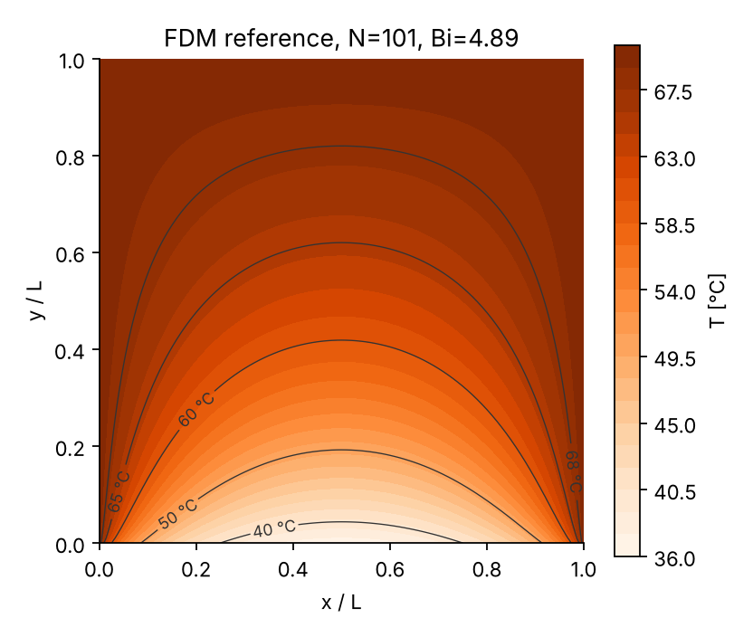
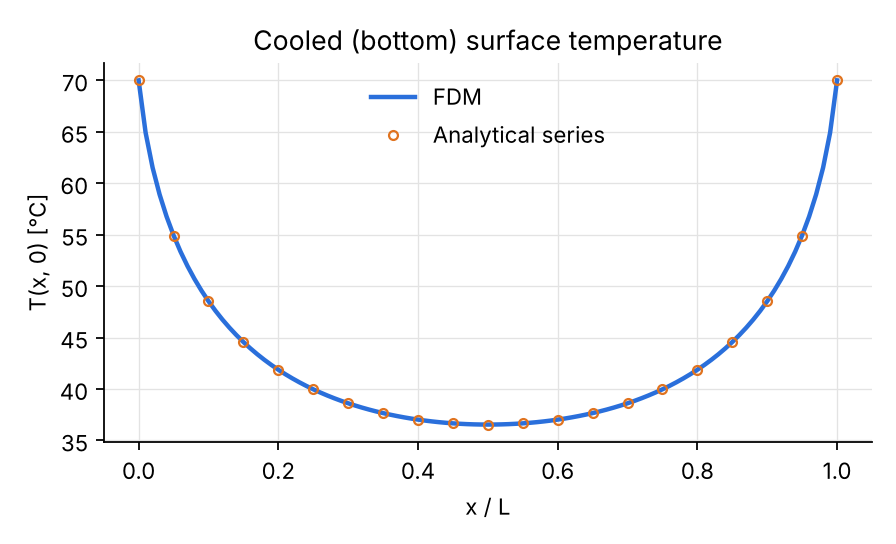
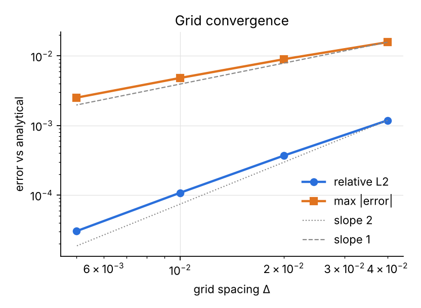
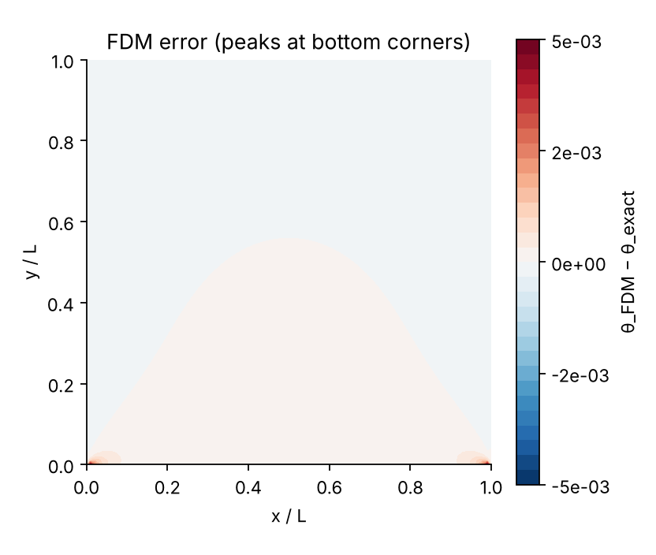

# Case 01 — PINN for 2D Heat Conduction

Kare çelik plaka, üç kenarı 70 °C, alt kenarı 20 °C suyla konvektif soğutuluyor.
Hedef: aynı problemi önce klasik sayısal yöntemle (FDM) çözüp referans almak, sonra
adım adım PINN'e geçmek.



## Yol haritası

| # | Adım | Durum |
|---|------|-------|
| 1 | Problemi tanımla (L, k, h, Bi) | ✅ |
| 2 | Boyutsuzlaştır | ✅ |
| 3 | Referans FDM çözücü + analitik doğrulama | ✅ |
| 4 | Forward PINN (sadece fizik, veri yok) | ⏳ |
| 5 | Doğrulama: L2 hata, hata haritası, alt yüzey ısı akısı | ⏳ |
| 6 | Hibrit PINN: seyrek + gürültülü referans verisi | ⏳ |
| 7 | Ters problem: Bi'yi iç sıcaklıklardan geri bul | ⏳ |
| 8 | Parametrik vekil model: girdi (x, y, Bi) | ⏳ |
| 9 | Framework karşılaştırması (DeepXDE / PhysicsNeMo) | ⏳ |

---

## 1. Problem tanımı

| Büyüklük | Değer |
|---|---|
| Plaka boyu L | 0.1 m (kare) |
| Malzeme | çelik, k = 49 W/m·K |
| Duvar sıcaklığı T_w (üst, sol, sağ) | 70 °C |
| Akışkan | su, U∞ = 1 m/s, T∞ = 20 °C |
| Alt kenar | konvektif soğutma, h |

**h — düz levha üzerinde laminer akış korelasyonu.** Su özellikleri 20 °C'de
(Incropera Tablo A.6): ν = 1.004×10⁻⁶ m²/s, k_f = 0.598 W/m·K, Pr = 7.01.

```
Re_L = U L / ν                 = 1.0 × 0.1 / 1.004e-6   ≈ 99 600   (< 5×10⁵ → laminer)
Nu_L = 0.664 Re_L^½ Pr^⅓       = 0.664 × 315.6 × 1.913  ≈ 401
h    = Nu_L k_f / L            = 401 × 0.598 / 0.1      ≈ 2 400 W/m²K
Bi   = h L / k_s               = 2 398 × 0.1 / 49       ≈ 4.9
```

Notlar:
- Senin verdiğin h = 2000 W/m²K ile Bi = 4.08. Fark %20 civarında; korelasyonun kendi
  belirsizliği (~±%15–20) ve film sıcaklığı seçimiyle aynı mertebede. Film sıcaklığında
  (~35 °C) özellik alınırsa h ≈ 2 600, Bi ≈ 5.3. Kodda varsayılan **Bi = 4.895**;
  `--Bi 4.08` ile değiştirilebilir.
- Korelasyon izotermal levha varsayar; alt yüzey burada 37–70 °C arasında değişiyor.
  Bu yüzden h sabit kabulü bir mühendislik yaklaşımıdır. İleride gerçek bir eşlenik
  (conjugate) CFD ile karşılaştırma ilginç bir yan adım olur.
- Bi ≈ 5 ≫ 0.1: plaka içinde güçlü sıcaklık gradyanı var — PINN için iyi bir test.

## 2. Boyutsuzlaştırma

```
θ = (T − T∞) / (T_w − T∞),    ξ = x / L,    η = y / L
```

Boyutsuz problem, ξ, η ∈ [0, 1]:

```
∂²θ/∂ξ² + ∂²θ/∂η² = 0                     (Laplace)
θ = 1                    ξ = 0, ξ = 1, η = 1  (70 °C duvarlar)
∂θ/∂η = Bi · θ           η = 0               (Robin / konveksiyon)
```

Robin koşulunun türetilmesi: alt yüzeyde dışarı (−y yönünde) çıkan iletim akısı,
konveksiyonla taşınan akıya eşit → k ∂T/∂y = h (T − T∞). L ve ΔT ile bölünce
∂θ/∂η = (hL/k) θ = Bi θ.

Tek fiziksel parametre Bi. Geometri ve sıcaklıklar ölçekten düştü — PINN'i boyutsuz
formda eğitmenin ana sebebi bu (girdi ve çıktılar O(1)).

Sıcaklık: T = 20 + 50 θ [°C]. Alt yüzeyden çıkan ısı (birim derinlik başına):

```
Q' = h L (T_w − T∞) ∫₀¹ θ(ξ, 0) dξ
```

## 3. Referans FDM çözücü

`fdm_solver.py`: düzgün N×N düğüm ağı, 2. mertebe merkezi farklar, Robin koşulu için
alt kenarda hayalet düğüm:

```
θ[i, −1] = θ[i, 1] − 2Δ·Bi·θ[i, 0]
⇒ θ[i−1,0] + θ[i+1,0] + 2θ[i,1] − (4 + 2Δ·Bi) θ[i,0] = 0
```

Alt köşeler yan duvarlara ait (θ = 1). Doğrusal sistem seyrek doğrudan çözücüyle çözülür.

**Analitik doğrulama.** Değişkenlere ayırma ile:

```
θ = 1 − Σ_{n tek} A_n sin(nπξ) sinh(nπ(1−η)),
A_n = (4 Bi / nπ) / (nπ cosh nπ + Bi sinh nπ)
```

### Sonuçlar (Bi = 4.895, N = 101)

| Büyüklük | Değer |
|---|---|
| Alt yüzey orta noktası θ(0.5, 0) | 0.331 → **36.5 °C** |
| Plakadaki min. sıcaklık | 36.5 °C |
| ∫ θ(ξ,0) dξ | 0.462 |
| Alt yüzeyden ısı çıkışı Q' | **≈ 5 540 W/m** (derinlik başına) |

Ağ yakınsaması (analitiğe göre):

| N | bağıl L2 | max \|hata\| |
|---|---|---|
| 26 | 1.2e-3 | 1.6e-2 |
| 51 | 3.7e-4 | 9.0e-3 |
| 101 | 1.1e-4 | 4.8e-3 |
| 201 | 3.0e-5 | 2.5e-3 |

L2 hatası ~2. mertebe yakınsıyor, maksimum hata ise yalnızca ~1. mertebe. Sebep alt
köşelerdeki tekillik: yan duvar θ = 1 isterken alt kenar soğuyor, köşede ∂θ/∂ξ
sonsuza gider. **PINN hatası da büyük olasılıkla tam burada toplanacak** — 5. adımda
sadece toplam kayba değil, hata haritasına bakacağız.





### Çalıştırma

```bash
pip install -r requirements.txt
python fdm_solver.py            # çözer, data/fdm_N101.{npz,csv} yazar
python fdm_solver.py --Bi 4.08  # h = 2000 W/m²K durumu
python plot_reference.py        # figures/*.png
```

`data/fdm_N101.npz` alanları: `x, y, theta, theta_exact, Bi, L, k, T_wall, T_inf`.
PINN adımlarında referans ve (6–7. adımlarda) seyrek "ölçüm" verisi buradan çekilecek.
