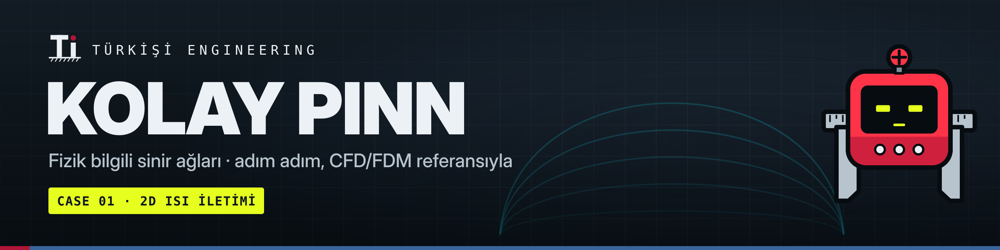
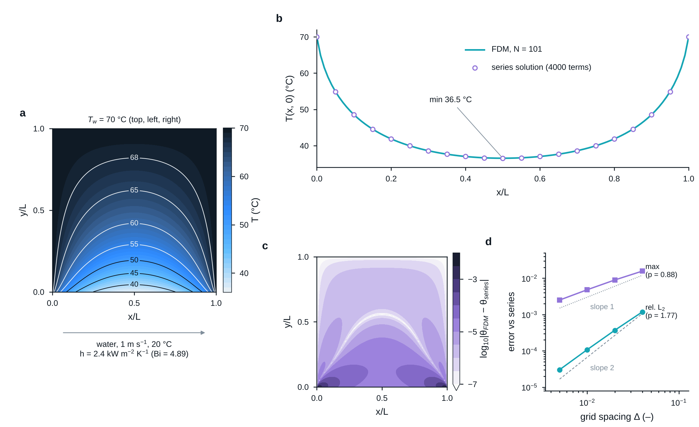
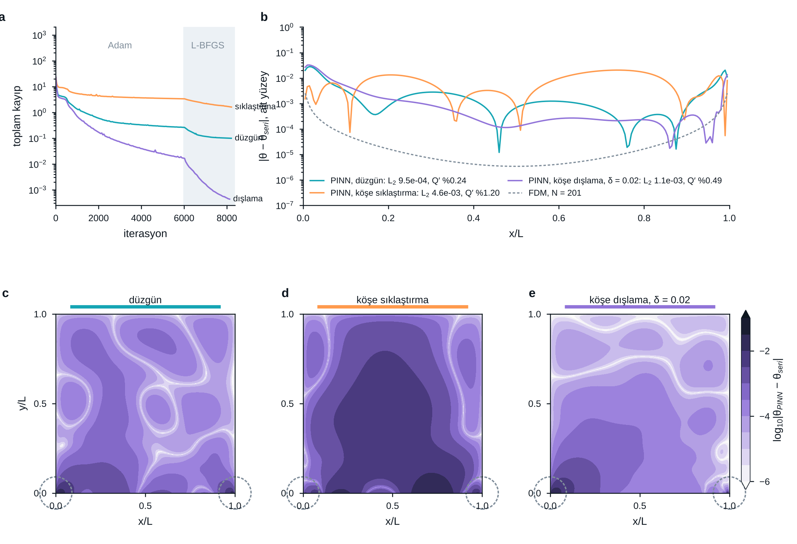
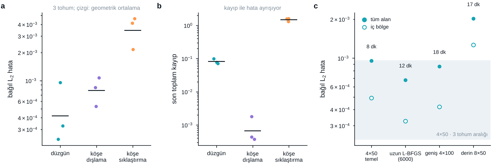
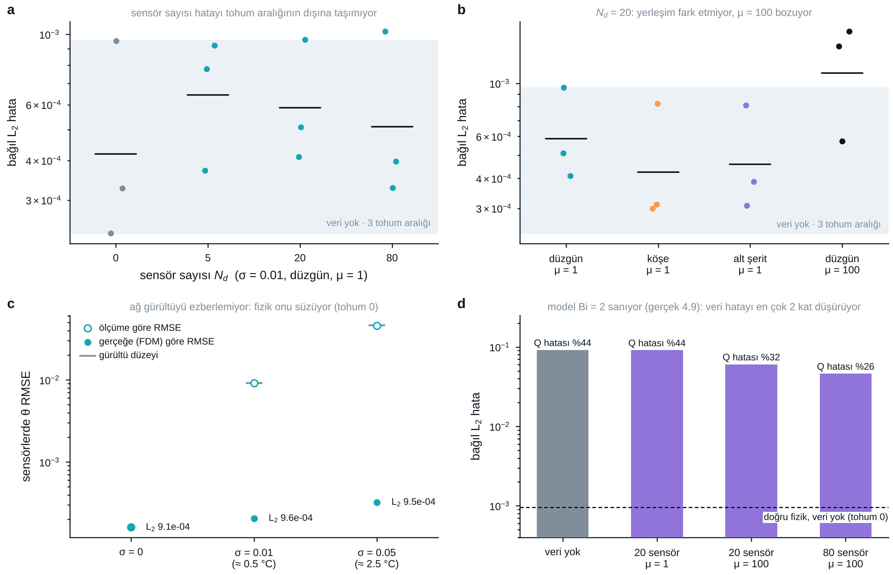
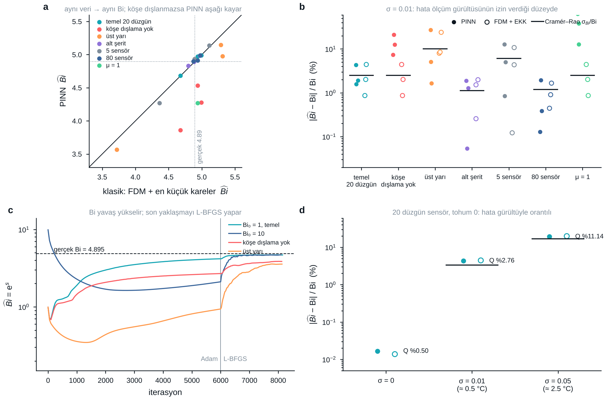

# Case 01 — PINN for 2D Heat Conduction

Kare çelik plaka, üç kenarı 70 °C, alt kenarı 20 °C suyla konvektif soğutuluyor.
Hedef: aynı problemi önce klasik sayısal yöntemle (FDM) çözüp referans almak, sonra
adım adım PINN'e geçmek.

🎓 **Ders 01 (26 slayt, ~50 dk, konuşmacı notlu):** [`lecture/ders01_2d_isi_iletimi_referans.pptx`](lecture/ders01_2d_isi_iletimi_referans.pptx)
📓 **Defter (adım adım, çalıştırılmış):** [`notebook/ders01_adim_adim_fdm.ipynb`](notebook/ders01_adim_adim_fdm.ipynb) — kodu satır satır kurup FDM sonucuna ve analitik doğrulamaya kadar götürür
📄 **Rapor (Adım 1–3):** [`report/case01_adim1-3_fdm_referans.pdf`](report/case01_adim1-3_fdm_referans.pdf)

**Ders 02 · Forward PINN (Adım 4–5)**
🎓 [`lecture/ders02/ders02_forward_pinn.pptx`](lecture/ders02/ders02_forward_pinn.pptx) ·
📓 [`notebook/ders02_forward_pinn.ipynb`](notebook/ders02_forward_pinn.ipynb) ·
📄 [`report/case01_adim4-5_forward_pinn.pdf`](report/case01_adim4-5_forward_pinn.pdf)

**Ders 03 · Hibrit PINN (Adım 6)**
🎓 [`lecture/ders03/ders03_hibrit_pinn.pptx`](lecture/ders03/ders03_hibrit_pinn.pptx) ·
📓 [`notebook/ders03_hibrit_pinn.ipynb`](notebook/ders03_hibrit_pinn.ipynb) ·
📄 [`report/case01_adim6_hibrit_pinn.pdf`](report/case01_adim6_hibrit_pinn.pdf)

## Yol haritası

| # | Adım | Durum |
|---|------|-------|
| 1 | Problemi tanımla (L, k, h, Bi) | ✅ |
| 2 | Boyutsuzlaştır | ✅ |
| 3 | Referans FDM çözücü + analitik doğrulama | ✅ |
| 4 | Forward PINN (sadece fizik, veri yok) | ✅ |
| 5 | Doğrulama: L2 hata, hata haritası, alt yüzey ısı akısı | ✅ |
| 6 | Hibrit PINN: seyrek + gürültülü referans verisi | ✅ |
| 7 | Ters problem: Bi'yi iç sıcaklıklardan geri bul | ✅ |
| 8 | Parametrik vekil model: girdi (x, y, Bi) | ⏳ |
| 9 | Framework karşılaştırması (DeepXDE / PhysicsNeMo) | ⏳ |

---

## 1. Problem tanımı

| Büyüklük | Değer |
|---|---|
| Plaka boyu L | 0.1 m (kare) |
| Malzeme | çelik, k = 49 W/m·K |
| Duvar sıcaklığı T_w (üst, sol, sağ) | 70 °C |
| Akışkan | su, U∞ = 1 m/s, T∞ = 20 °C |
| Alt kenar | konvektif soğutma, h |

**h — düz levha üzerinde laminer akış korelasyonu.** Su özellikleri 20 °C'de
(Incropera Tablo A.6): ν = 1.004×10⁻⁶ m²/s, k_f = 0.598 W/m·K, Pr = 7.01.

```math
\begin{aligned}
\mathrm{Re}_L &= \frac{U L}{\nu} = \frac{1.0 \times 0.1}{1.004\times10^{-6}} \approx 99\,600 \quad (< 5\times10^5 \Rightarrow \text{laminer}) \\
\overline{\mathrm{Nu}}_L &= 0.664\,\mathrm{Re}_L^{1/2}\,\mathrm{Pr}^{1/3} = 0.664 \times 315.6 \times 1.913 \approx 401 \\
\bar h &= \frac{\overline{\mathrm{Nu}}_L\,k_f}{L} = \frac{401 \times 0.598}{0.1} \approx 2\,400\ \mathrm{W\,m^{-2}\,K^{-1}} \\
\mathrm{Bi} &= \frac{\bar h\,L}{k} = \frac{2398 \times 0.1}{49} \approx 4.9
\end{aligned}
```

Notlar:
- Senin verdiğin h = 2000 W/m²K ile Bi = 4.08. Fark %20 civarında; korelasyonun kendi
  belirsizliği (~±%15–20) ve film sıcaklığı seçimiyle aynı mertebede. Film sıcaklığında
  (~35 °C) özellik alınırsa h ≈ 2 600, Bi ≈ 5.3. Kodda varsayılan **Bi = 4.895**;
  `--Bi 4.08` ile değiştirilebilir.
- Korelasyon izotermal levha varsayar; alt yüzey burada 37–70 °C arasında değişiyor.
  Bu yüzden h sabit kabulü bir mühendislik yaklaşımıdır. İleride gerçek bir eşlenik
  (conjugate) CFD ile karşılaştırma ilginç bir yan adım olur.
- $\mathrm{Bi} \approx 5 \gg 0.1$: plaka içinde güçlü sıcaklık gradyanı var — PINN için iyi bir test.

## 2. Boyutsuzlaştırma

```math
\theta = \frac{T - T_\infty}{T_w - T_\infty}, \qquad \xi = \frac{x}{L}, \qquad \eta = \frac{y}{L}
```

Boyutsuz problem, $(\xi, \eta) \in [0,1]^2$:

```math
\begin{aligned}
&\frac{\partial^2\theta}{\partial\xi^2} + \frac{\partial^2\theta}{\partial\eta^2} = 0 && \text{(Laplace)} \\
&\theta = 1, \quad \xi = 0,\ \xi = 1,\ \eta = 1 && \text{(duvarlar, } 70\,^\circ\mathrm{C}\text{)} \\
&\frac{\partial\theta}{\partial\eta} = \mathrm{Bi}\,\theta, \quad \eta = 0 && \text{(Robin / konveksiyon)}
\end{aligned}
```

Robin koşulunun türetilmesi: alt yüzeyde dışarı (−y yönünde) çıkan iletim akısı, konveksiyonla taşınan
akıya eşit; $T - T_\infty = \Delta T\,\theta$ ve $y = L\eta$ yazınca $\Delta T$ sadeleşir:

```math
k\,\frac{\partial T}{\partial y} = h\,(T - T_\infty)
\quad\Longrightarrow\quad
\frac{\partial\theta}{\partial\eta} = \frac{hL}{k}\,\theta = \mathrm{Bi}\,\theta
```

Tek fiziksel parametre Bi. Geometri ve sıcaklıklar ölçekten düştü — PINN'i boyutsuz
formda eğitmenin ana sebebi bu (girdi ve çıktılar O(1)).

Sıcaklık: $T = 20 + 50\,\theta$ [°C]. Alt yüzeyden çıkan ısı (birim derinlik başına):

```math
Q' = \bar h\,L\,(T_w - T_\infty) \int_0^1 \theta(\xi, 0)\,d\xi
```

## 3. Referans FDM çözücü

`fdm_solver.py`: düzgün N×N düğüm ağı, 2. mertebe merkezi farklar, Robin koşulu için
alt kenarda hayalet düğüm:

```math
\begin{aligned}
&\theta_{i+1,j} + \theta_{i-1,j} + \theta_{i,j+1} + \theta_{i,j-1} - 4\,\theta_{i,j} = 0 && \text{(iç düğüm)} \\
&\theta_{i,-1} = \theta_{i,1} - 2\Delta\,\mathrm{Bi}\,\theta_{i,0} && \text{(hayalet düğüm)} \\
&\theta_{i-1,0} + \theta_{i+1,0} + 2\,\theta_{i,1} - (4 + 2\Delta\,\mathrm{Bi})\,\theta_{i,0} = 0 && \text{(alt kenar)}
\end{aligned}
```

Alt köşeler yan duvarlara ait ($\theta = 1$). Doğrusal sistem seyrek doğrudan çözücüyle çözülür.

**Analitik doğrulama.** Değişkenlere ayırma ile:

```math
\theta(\xi,\eta) = 1 - \sum_{n\ \text{tek}} A_n \sin(n\pi\xi)\,\sinh\big(n\pi(1-\eta)\big),
\qquad
A_n = \frac{4\,\mathrm{Bi}/(n\pi)}{n\pi\cosh(n\pi) + \mathrm{Bi}\,\sinh(n\pi)}
```

### Sonuçlar (Bi = 4.895, N = 101)

| Büyüklük | Değer |
|---|---|
| Alt yüzey orta noktası θ(0.5, 0) | 0.331 → **36.5 °C** |
| Plakadaki min. sıcaklık | 36.5 °C |
| ∫ θ(ξ,0) dξ | 0.462 |
| Alt yüzeyden ısı çıkışı Q' | **≈ 5 540 W/m** (derinlik başına) |

Ağ yakınsaması (analitiğe göre):

| N | bağıl L2 | max \|hata\| |
|---|---|---|
| 26 | 1.2e-3 | 1.6e-2 |
| 51 | 3.7e-4 | 9.0e-3 |
| 101 | 1.1e-4 | 4.8e-3 |
| 201 | 3.0e-5 | 2.5e-3 |

L2 hatası ~2. mertebe yakınsıyor, maksimum hata ise yalnızca ~1. mertebe. Sebep alt
köşelerdeki tekillik: yan duvar θ = 1 isterken alt kenar soğuyor, köşede ∂θ/∂ξ
sonsuza gider. **PINN hatası da büyük olasılıkla tam burada toplanacak** — 5. adımda
sadece toplam kayba değil, hata haritasına bakacağız.



**Fig. 1 | İkinci mertebe FDM seri çözümü yeniden üretiyor; hata alt köşelerdeki tekillikte toplanıyor.**
**a**, N = 101 ağında sıcaklık alanı, izotermler °C. **b**, soğutulan yüzeyin sıcaklığı: FDM (çizgi) ve 4000
terimli seri çözüm (her 5. düğüm). **c**, mutlak hatanın log₁₀ haritası; açık bant hatanın işaret değiştirdiği
yer. **d**, N = 26–201 için bağıl L₂ ve maksimum hata; p en küçük kareler eğimi (L₂: 1.77, maks.: 0.88).
Vektör sürümler: [`fig01_fdm_reference.pdf`](figures/fig01_fdm_reference.pdf) · [`.svg`](figures/fig01_fdm_reference.svg)

## 4–5. Forward PINN ve doğrulama

`pinn_forward.py`: MLP (4 × 50, tanh, float64), Dirichlet kenarları katı kısıtla ağın yapısına gömülü,
kayıp yalnız PDE ve Robin artıkları, eğitim Adam (6000) → L-BFGS (≤ 2000).

```math
\hat\theta(\xi,\eta) = 1 + \xi\,(1-\xi)\,(1-\eta)\,\mathcal{N}(\xi,\eta)
```

```math
\mathcal{L} = \frac{1}{N_r}\sum_{k=1}^{N_r} \big(\nabla^2\hat\theta(\mathbf{x}_k)\big)^2
+ \frac{\lambda}{N_b}\sum_{m=1}^{N_b} \Big(\frac{\partial\hat\theta}{\partial\eta} - \mathrm{Bi}\,\hat\theta\Big)^2_{(\xi_m,\,0)},
\qquad \lambda = 1
```

Üç kolokasyon stratejisi, seri çözüme karşı (201 × 201 ağ):

| | Son kayıp | Bağıl L₂ | İç bölge L₂ | Maks. hata | Q′ hatası | Süre (2 CPU) |
|---|---|---|---|---|---|---|
| FDM, N = 201 | — | 3.0e-05 | — | — | — | < 1 s |
| PINN, düzgün | 9.9e-02 | **9.5e-04** | 4.9e-04 | 2.8e-02 | **%0.24** | 492 s |
| PINN, köşe sıklaştırma | 1.6e+00 | 4.6e-03 | 4.5e-03 | 2.0e-02 | %1.20 | 607 s |
| PINN, köşe dışlama (δ = 0.02) | **4.3e-04** | 1.1e-03 | 5.2e-04 | 3.2e-02 | %0.49 | 467 s |



**Fig. 2 | Köşeye nokta eklemek hatayı artırır; köşeyi dışlamak kaybı düşürür ama hatayı değiştirmez.**
**a**, toplam kayıp (gri: L-BFGS). **b**, alt yüzey boyunca seri çözüme göre hata; kesikli çizgi FDM. **c–e**, log₁₀ hata haritaları.
Vektör: [`fig02_pinn_forward.pdf`](figures/fig02_pinn_forward.pdf) · [`.svg`](figures/fig02_pinn_forward.svg)

#### Sağlamlık: üç tohum, kapasite ve eğitim süresi

Tohum (0, 1, 2) hem ağırlık başlatmayı hem Sobol kolokasyonunu değiştirir. `python study_runs.py` (2 CPU'da ~100 dk) → `python study_summary.py`.

| Strateji (3 tohum) | Bağıl L₂ ort. ± std | Aralık | İç bölge L₂ | Q′ hatası | Son kayıp |
|---|---|---|---|---|---|
| düzgün | 5.1e-04 ± 3.9e-04 | 2.4e-04 – 9.5e-04 | 3.2e-04 | %0.12 | 8.2e-02 |
| köşe dışlama | 8.2e-04 ± 2.7e-04 | 5.3e-04 – 1.1e-03 | 4.0e-04 | %0.42 | 8.7e-04 |
| köşe sıklaştırma | 3.6e-03 ± 1.3e-03 | 2.2e-03 – 4.6e-03 | 3.5e-03 | %0.71 | 1.5e+00 |

| Tek değişiklik (tohum 0) | Parametre | Bağıl L₂ | İç bölge L₂ | Süre |
|---|---|---|---|---|
| 4×50, temel | 7 851 | 9.5e-04 | 4.9e-04 | 8 dk |
| uzun L-BFGS (6000) | 7 851 | 6.8e-04 | 3.3e-04 | 12 dk |
| geniş 4×100 | 30 701 | 8.6e-04 | 4.2e-04 | 18 dk |
| derin 8×50 | 18 051 | 2.0e-03 | 1.3e-03 | 17 dk |



**Fig. 3 | Köşe sıklaştırmanın zararı ve kayıp–hata ayrışması üç tohumda da korunur; kapasite artışı tohum aralığını aşmaz.**
**a**, bağıl L₂ hata, üç tohum; çizgi geometrik ortalama. **b**, son toplam kayıp. **c**, temel ayara göre tek değişiklik; gri bant 4×50'nin tohum aralığı.
Vektör: [`fig03_robustness.pdf`](figures/fig03_robustness.pdf) · [`.svg`](figures/fig03_robustness.svg)

**Bulgular**
1. **Kayıp tabanını köşe çelişkisi belirler.** Alt köşede yan duvar $\partial\theta/\partial\eta = 0$ ister, Robin
   $\partial\theta/\partial\eta = \mathrm{Bi}$ ister; hiçbir düzgün fonksiyon ikisini sağlayamaz. Kenarın %2'lik köşe şeridi
   Robin kaybında ~%97 paya sahip, köşede artık $|r| = \mathrm{Bi}$.
2. **FDM sezgisi PINN'e taşınmaz.** Köşeye nokta eklemek bağıl L₂'yi tohum 0'da 4.8 kat, üç tohum ortalamasında
   7.2 kat artırdı (her tohumda daha kötü); sağlanamaz artıklar kaybı domine edip iç bölgeyi bozdu.
3. **Kayıp ≠ doğruluk.** Köşe dışlama kaybı ortalamada 95 kat düşürdü; hata aralığı düzgün kolokasyonla örtüşüyor.
4. **Tohum, kapasiteden büyük etken.** Yalnız tohum hatayı 4 kat oynatıyor (tohum 0 en kötüsü);
   uzun L-BFGS ve 4×100 bu aralıkta kaldı, 8×50 daha kötü. Sonuçlar en az üç tohumla raporlanmalı.
5. **Bu problemde FDM üstün.** PINN'in değeri ölçüm verisi (Adım 6), bilinmeyen parametre (Adım 7) ve parametrik çözümde (Adım 8).

---
## 6. Hibrit PINN: fizik + seyrek gürültülü ölçüm

`pinn_hybrid.py`: Adım 4'ün ağı ve eğitimi, kayba bir veri terimi eklenmiş. Ölçümler FDM (N = 201) iç düğümlerinden, Gauss gürültüsüyle.
`python hybrid_runs.py` (24 koşu, 2 CPU'da ~3.5 saat) → `python hybrid_summary.py`.

```math
\mathcal{L} = \mathcal{L}_{\mathrm{PDE}} + \lambda\,\mathcal{L}_{\mathrm{Robin}}
+ \mu\,\frac{1}{N_d}\sum_{i=1}^{N_d}\big(\hat\theta(\mathbf{x}_i) - \theta_i^{\mathrm{ö}}\big)^2,
\qquad \theta_i^{\mathrm{ö}} = \theta_{\mathrm{FDM}}(\mathbf{x}_i) + \varepsilon_i,\quad \varepsilon_i \sim \mathcal{N}(0, \sigma^2)
```

Doğru fizik (Bi = 4.895), σ = 0.01 (≙ 0.5 °C), 3 tohum:

| Yapılandırma | Bağıl L₂ geo. ort. | Aralık | Veri yok'a oran |
|---|---|---|---|
| N_d = 0 · düzgün · μ = 1 | 4.2e-04 | 2.4e-04 – 9.5e-04 | 1.00 |
| N_d = 5 · düzgün · μ = 1 | 6.4e-04 | 3.7e-04 – 9.2e-04 | 1.54 |
| N_d = 20 · düzgün · μ = 1 | 5.9e-04 | 4.1e-04 – 9.6e-04 | 1.40 |
| N_d = 80 · düzgün · μ = 1 | 5.1e-04 | 3.3e-04 – 1.0e-03 | 1.22 |
| N_d = 20 · köşe, μ = 1 | 4.2e-04 | 3.0e-04 – 8.2e-04 | 1.01 |
| N_d = 20 · alt şerit, μ = 1 | 4.6e-04 | 3.1e-04 – 8.1e-04 | 1.10 |
| N_d = 20 · düzgün, μ = 100 | 1.1e-03 | 5.7e-04 – 1.6e-03 | 2.64 |

Yanlış fizik (kayıpta Bi = 2; ölçüm ve doğrulama gerçek Bi ile), tohum 0; doğru fizik, veri yok: 9.5e-04:

| Koşu | Bağıl L₂ | Q′ hatası |
|---|---|---|
| veri yok | 9.2e-02 | %43.8 |
| 20 sensör μ = 1 | 9.1e-02 | %43.6 |
| 20 sensör μ = 100 | 6.1e-02 | %32.0 |
| 80 sensör μ = 100 | 4.6e-02 | %26.0 |



**Fig. 4 | Fizik doğruyken seyrek veri hatayı değiştirmez; fizik yanlışken hatayı yalnız sınırlı ölçüde düşürür.**
**a**, sensör sayısı; gri bant veri yok koşularının aralığı. **b**, yerleşim ve veri ağırlığı. **c**, sensörlerde ağın ölçüme (boş) ve gerçeğe (dolu) göre RMS farkı. **d**, yanlış fizik; etiketler Q′ hatası.
Vektör: [`fig04_hybrid.pdf`](figures/fig04_hybrid.pdf) · [`.svg`](figures/fig04_hybrid.svg)

**Bulgular**
1. **Doğru fizikte seyrek veri bilgi taşımaz.** 5/20/80 sensör, köşe ve alt şerit yerleşimi, gürültüsüz veri bile hatayı veri yok
   aralığının dışına taşımadı. Veri yokken modelin RMS hatası (≈ 3.6e-04) σ/√N_d'den küçük;
   ölçütün sağlanması için ~760 sensör gerekirdi.
2. **Fizik gürültüyü süzer.** σ = 0.01'de ağ sensörlerde ölçüme 9.2e-03 (≈ σ), gerçeğe 2.1e-04 uzak;
   σ = 0.05'te de bağıl L₂ değişmedi.
3. **Büyük μ zarar verir.** μ = 100 hatayı ortalamada 2.6 kat artırdı: ağ gürültüye doğru bükülüyor.
   μ = 1'de ise veri terimi (≈ σ² = 1e-4) köşe çelişkisinin kayıp tabanının (≈ 0.08) binde biri.
4. **Yanlış fizikte veri sınırlı.** Bi = 2 ile hata doğru fiziğin 96 katı; veri en çok 2.0 kat düşürdü
   (Q′ hatası %44 → %26). Yanlış Robin ile ölçümler çekişiyor;
   çözüm Bi'yi öğrenmek (Adım 7).

## 7. Ters problem: Bi'yi iç sıcaklıklardan geri bulmak

`pinn_inverse.py`: Adım 6'nın hibrit kaybı, ama Bi bilinmiyor ve logaritmik bir parametreyle ağla birlikte öğreniliyor. `s` ayrı bir Adam grubunda, lr = 1e-2.
Klasik taban `inverse_classical.py`: aynı sensör ve gürültüyle FDM (N = 101) + `least_squares`. Duyarlılık ve Cramér–Rao sınırı da burada hesaplanıyor.
`python inverse_runs.py` (24 koşu, ~500 s/koşu) → `python inverse_summary.py`.

```math
\min_{\mathbf{w},\,s}\;\mathcal{L}_{\mathrm{PDE}} + \lambda\,\frac{1}{N_b}\sum\Big(\frac{\partial\hat\theta}{\partial\eta} - e^{s}\hat\theta\Big)^2
+ \mu\,\frac{1}{N_d}\sum_{i}\big(\hat\theta(\mathbf{x}_i) - \theta_i^{\mathrm{ö}}\big)^2,
\qquad \mathrm{Bi} = e^{s}
```

```math
S(\mathbf{x}) = \frac{\partial\theta}{\partial \mathrm{Bi}},\qquad
\sigma_{\mathrm{Bi}} \;\ge\; \frac{\sigma}{\sqrt{\sum_i S(\mathbf{x}_i)^2}}\quad\text{(Cramér–Rao)}
```

Gerçek Bi = 4.895, Bi₀ = 1, σ = 0.01 (≙ 0.5 °C), μ = 100. Köşeden δ = 0.02 içindeki Robin noktaları kayba girmiyor. Her deney 3 tohum:

| Deney | PINN Bi | FDM + EKK Bi | PINN hata | EKK hata | CRB σ/Bi |
|---|---|---|---|---|---|
| 20 düzgün (temel) | 4.682 · 4.972 · 4.988 | 4.676 · 4.937 · 4.993 | %2.6 | %2.4 | %2.5 |
| 20 alt şerit (η < 0.1) | 4.832 · 4.892 · 4.987 | 4.796 · 4.882 · 4.970 | %1.1 | %1.3 | %1.1 |
| 20 üst yarı (η > 0.5) | 3.568 · 5.145 · 4.975 | 3.719 · 5.288 · 5.311 | %11.3 | %13.5 | %10.1 |
| 5 düzgün | 5.139 · 4.936 · 4.270 | 5.110 · 4.889 · 4.362 | %6.2 | %5.1 | %6.1 |
| 80 düzgün | 4.989 · 4.901 · 4.913 | 4.976 · 4.873 · 4.939 | %0.8 | %1.0 | %1.2 |
| 20 düzgün, δ = 0 (köşe dahil) | 3.861 · 4.532 · 4.277 | (temel ile aynı) | %13.7 | %2.4 | %2.5 |
| 20 düzgün, μ = 1 | 1.818 · 4.270 · 3.034 | (temel ile aynı) | %37.9 | %2.4 | %2.5 |

Tek tohumlu ek koşular:
- Gürültüsüz ölçüm: Bi hatası %0.02.
- σ = 0.05: hata %19.2, CRB %16.8.
- Bi₀ = 10'dan başlama: 4.70. Aynı tohumla Bi₀ = 1'den 4.68.



**Fig. 8 | PINN, Bi'yi aynı veriden klasik yöntemle aynı doğrulukta bulur; belirsizliği ölçüm belirler, yöntem değil.**
**a**, PINN Bi'ye karşı FDM + EKK Bi (aynı sensörler, aynı gürültü). **b**, deney başına hata: dolu PINN, boş EKK, çizgi Cramér–Rao sınırı. **c**, eğitim boyunca Bi tahmini. **d**, gürültü düzeyi.
Vektör: [`fig08_inverse.pdf`](figures/fig08_inverse.pdf) · [`.svg`](figures/fig08_inverse.svg)

**Bulgular**
1. **Hata Cramér–Rao sınırında.** Köşe dışlamalı ve μ = 100 olan her deneyde PINN hatası sınır mertebesinde, sistematik olarak üstünde değil.
   Aynı veride |PINN − EKK|/Bi ortanca %0.59, en çok %6.9; bu en büyük fark, en az bilgili yerleşim olan üst yarıda çıktı. Kalan belirsizlik ölçümden geliyor.
2. **Bilgi soğutulan yüzeyde.** |∂θ/∂Bi| en çok 0.050 (alt yüzey ortası), merkezde 0.0122, üst yarıda ≤ 0.012.
   Aynı 20 sensörle sınır alt şeritte %1.1, düzgün dağılımda %2.5, üst yarıda %10.1. Alt şeritteki 20 sensör, düzgün dağılmış 80 sensör (%1.2) kadar bilgi taşıyor.
   Deneyi yapmadan önce sınır hesaplanabilir.
3. **Köşe çelişkisi Bi'yi aşağı çeker.** Köşede Robin artığı −Bi ve ∂r²/∂Bi = 2Bi θ² > 0.
   Köşe noktaları kayıptaysa (δ = 0) Bi ortalama 0.65 düşük çıkıyor; δ = 0.02 bu yanlılığı kaldırıyor.
4. **Veri ağırlığı tanımlanabilirliği belirler.** μ = 1'de veri terimi PDE ve Robin terimlerinin yanında çok küçük kalıyor ve Bi 1.8–4.3 arasında dağılıyor.
   Adım 6'da zarar veren μ = 100 burada gerekli. Tek parametreli bir modelde gürültüye bükülecek serbestlik yok.
5. **Maliyet.** PINN koşusu ~505 s, FDM + EKK ~1.0 s (~500 kat). Bu problem kadar ucuz bir ileri çözücü varsa klasik yöntem daha iyi seçim.
   PINN'in avantajı, ileri çözümün pahalı olduğu ya da bilinmeyenin bir alan (h(ξ)) olduğu durumlarda; bu da parametrik PINN'e yol açıyor (Adım 8).

Ders: [`lecture/ders04/ders04_ters_problem.pptx`](lecture/ders04/ders04_ters_problem.pptx) · Defter: [`notebook/ders04_ters_problem.ipynb`](notebook/ders04_ters_problem.ipynb) · Rapor: [`report/case01_adim7_ters_problem.pdf`](report/case01_adim7_ters_problem.pdf)

### Çalıştırma

```bash
pip install -r requirements.txt
python fdm_solver.py            # çözer, data/fdm_N101.{npz,csv} yazar
python fdm_solver.py --Bi 4.08  # h = 2000 W/m²K durumu
python plot_reference.py        # figures/fig01_fdm_reference.{pdf,svg,png} + data/summary.json
python make_report.py           # report/case01_adim1-3_fdm_referans.pdf
python notebook/build_notebook.py   # defteri üretir ve çalıştırır (jupyter: nbformat, nbclient, ipykernel)
python lecture/equations.py && python lecture/make_slide_figures.py && node lecture/build_lecture.js   # ders destesi (önce kökte: npm install; ayrıca pdflatex + pandoc)

# Adım 4–5 (her koşu 2 CPU çekirdeğinde ~8–10 dk)
python pinn_forward.py --tag uniform
python pinn_forward.py --corner --tag corner
python pinn_forward.py --skip 0.02 --tag skip
python plot_pinn.py                 # figures/fig02_pinn_forward.* + data/summary_pinn.json
python study_runs.py && python study_summary.py   # sağlamlık: fig03_robustness.* + data/summary_study.json
python make_report_pinn.py          # report/case01_adim4-5_forward_pinn.pdf
python lecture/ders02/equations.py && python lecture/ders02/make_slide_figures.py && node lecture/ders02/build_lecture.js
python notebook/build_notebook_ders02.py

# Adım 6
python hybrid_runs.py && python hybrid_summary.py   # fig04_hybrid.* + data/summary_hybrid.json
python make_report_hybrid.py        # report/case01_adim6_hibrit_pinn.pdf
python lecture/ders03/equations.py && python lecture/ders03/make_slide_figures.py && node lecture/ders03/build_lecture.js
python notebook/build_notebook_ders03.py

# Adım 7
python inverse_classical.py         # ∂θ/∂Bi, Cramér–Rao, FDM + EKK -> data/inverse_classical.json
python inverse_runs.py && python inverse_summary.py   # 24 koşu; fig08_inverse.* + data/summary_inverse.json
python make_report_inverse.py       # report/case01_adim7_ters_problem.pdf
python lecture/ders04/equations.py && python lecture/ders04/make_slide_figures.py && node lecture/ders04/build_lecture.js
python notebook/build_notebook_ders04.py
```

`data/fdm_N101.npz` alanları: `x, y, theta, theta_exact, Bi, L, k, T_wall, T_inf`.
PINN adımlarında referans ve (6–7. adımlarda) seyrek "ölçüm" verisi buradan çekilecek.
`runs/<tag>/`: `model.pt`, `history.npz`, `prediction.npz` (201 × 201: PINN, seri, FDM), `metrics.json`.
